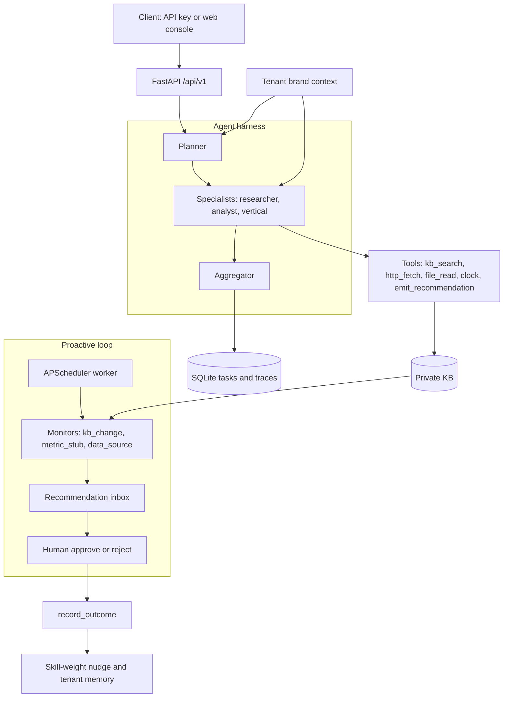

# ProAgent OS

[](LICENSE)
[](https://www.python.org/)
[](https://github.com/jahonn/ProAgent-OS/issues)
[](https://github.com/jahonn/ProAgent-OS/actions/workflows/ci.yml)

**Self-hosted harness for commercial agent products.** A planner–specialist loop, a private knowledge base, proactive human approval, and a small outcome loop, exposed as a multi-tenant FastAPI app.

Product name: **ProAgent OS** (`proagent-os`). Original design and code. It is an independent project and is not affiliated with any third-party agent product.

> Status: **MVP / early open source** (0.1.0). Suitable for demos, scaffolding vertical packs, and self-hosted experiments. Read the [roadmap (issue #2)](https://github.com/jahonn/ProAgent-OS/issues/2) before any production SaaS use. History: [CHANGELOG.md](CHANGELOG.md).

**Scan:** [Who it is for](#who-it-is-for) · [Quick start](#quick-start-mock-llm) · [Positioning](#positioning) · [Architecture](#architecture) · [Retrieval](#retrieval-modes) · [Roadmap](#roadmap)

## Who it is for

- Product teams packaging a vertical agent (support, sales, ops research) who want tenants, a private KB, and an approval inbox in one service.
- Engineers who want an offline mock run first, then the same HTTP API against any OpenAI-compatible `/v1/chat/completions` endpoint.
- Builders who will add a vertical pack (`verticals/<name>/` agents and skills) without editing the harness.
- Early adopters who can live with one SQLite file, stub embeddings, and approve/reject that records the decision only.

## Quick start (mock LLM)

Mock LLM, no API keys. The offline script is the one-minute path to a green run. Step-by-step output is in [docs/DEMO.md](docs/DEMO.md).

```bash
git clone https://github.com/jahonn/ProAgent-OS.git
cd ProAgent-OS
python3 -m venv .venv
source .venv/bin/activate   # Windows: .venv\Scripts\activate
pip install -r requirements.txt
pip install -e .

python scripts/demo.py      # offline demo → data/demo.db (gitignored)
```

You should see a completed task, an approved recommendation titled `Conversion below 2.5% target`, and a dashboard snapshot. Ids change every run. The demo tenant key is `pk_demo_acme_analytics`.

Serve that same database (the demo key lives in `data/demo.db`, not in a fresh file):

```bash
export PROAGENT_ADMIN_KEY=dev-admin-key
export PROAGENT_LLM_PROVIDER=mock
export PROAGENT_DB_PATH=./data/demo.db
uvicorn proagent_os.main:app --host 0.0.0.0 --port 8080

# optional proactive worker (separate process, same DB)
python -m proagent_os.worker
```

Open http://localhost:8080 and paste `pk_demo_acme_analytics`. API docs: http://localhost:8080/docs.

To start from an empty database instead, set `PROAGENT_DB_PATH=./data/proagent.db` and create a tenant:

```bash
curl -s -X POST http://localhost:8080/api/v1/tenants \
  -H "Authorization: Bearer dev-admin-key" \
  -H "Content-Type: application/json" \
  -d '{"name":"Acme","goals":"Grow conversion","tone":"concise"}'
```

Use the returned `api_key` as `Authorization: Bearer …` for tenant APIs.

## Positioning

ProAgent OS is a runnable product harness: private KB, proactive human-in-the-loop, an outcome log, and FastAPI tenants. LangChain-style libraries and CrewAI-style crews are toolkits for assembling agent behavior; you bring the product shell. Pick the toolkit when you want that composability.

| | ProAgent OS | LangChain-style libraries | CrewAI-style crews |
|---|---|---|---|
| What you run | A harness: API, worker, console, SQLite | A library of chains, tools, retrievers, and graphs | A library of role-based agents, tasks, and crews |
| Agent shape | Planner → specialists (native tool calls) → aggregator | The graph or chain you compose | The crew and tasks you define |
| Knowledge | Per-tenant KB. BM25 by default; optional offline hybrid stub | Retrievers and stores you connect | Knowledge sources you attach |
| Proactive HITL | Interval monitors file recommendations; the API records approve or reject | Human-input steps you add to your graph | Human-input steps you add to your crew or flow |
| Outcome loop | `record_outcome` stores a metric and nudges a skill weight | Evaluation in the tools you place around the library | Evaluation in the tools you place around the library |
| Tenancy | FastAPI `/api/v1` and one Bearer API key per tenant | Your service owns auth and tenancy | Your service owns auth and tenancy |
| This release | v0.1.0 early MVP. Approve stores a status and does not run the action | Large ecosystem; production shape is yours | Large ecosystem; production shape is yours |

## Architecture

Planner and aggregator stay text-only. Specialists call tools natively, for up to `PROAGENT_MAX_TOOL_ROUNDS` rounds (JSON-in-content is still accepted).



**Built-in tools:** `http_fetch` · `file_read` · `kb_search` · `clock` · `emit_recommendation`

**Core agents:** `planner` · `researcher` · `analyst` · `aggregator` (plus agents merged from `verticals/*/agents/`)

## Features

| Layer | In this MVP |
|-------|-------------|
| **Agent harness** | Planner → specialists → aggregator. YAML registry. Native OpenAI-style tool calls (multi-round). SQLite tasks and traces. |
| **Professional** | Ingest URL/HTML and md/txt/html/pdf (PDF is best-effort). BM25, plus an optional offline hybrid stub. Brand context and skill packs. |
| **Proactive** | Interval monitors (`kb_change`, `metric_stub`, `data_source`). Recommendation inbox. Approve/reject API. APScheduler worker. Approve updates status only. |
| **Profitable** | `record_outcome`. Skill-weight nudges and tenant-memory feedback (a score nudge, not a trained policy). Dashboard API. |
| **Commercial surface** | FastAPI `/api/v1`, one Bearer API key per tenant, web console, Docker Compose. |

## Real LLM (OpenAI-compatible)

Any OpenAI-compatible `/v1/chat/completions` endpoint works (OpenAI, Xiaomi Mimo Token Plan, DeepSeek, vLLM, and others).

```bash
cp .env.example .env
# edit .env — never commit it

export PROAGENT_LLM_PROVIDER=openai
export PROAGENT_LLM_BASE_URL=https://api.openai.com/v1   # or your /v1 endpoint
export PROAGENT_LLM_API_KEY=sk-...
export PROAGENT_LLM_MODEL=gpt-4o-mini
export PROAGENT_MAX_TOOL_ROUNDS=8

python scripts/demo_live.py   # prints multi-round tool traces
```

## Docker Compose

```bash
export PROAGENT_ADMIN_KEY=dev-admin-key
docker compose up --build
```

- API/UI: http://localhost:8080
- Services: `api` + `worker` sharing a SQLite volume
- This path starts a fresh database volume. Create a tenant with the curl above; it does not load `data/demo.db`.

## Environment variables

| Variable | Default | Meaning |
|----------|---------|---------|
| `PROAGENT_ADMIN_KEY` | `dev-admin-key` | Bootstrap / list tenants |
| `PROAGENT_DB_PATH` | `./data/proagent.db` | SQLite path |
| `PROAGENT_LLM_PROVIDER` | `mock` | `mock` or `openai` (OpenAI-compatible) |
| `PROAGENT_LLM_BASE_URL` | `https://api.openai.com/v1` | Compatible `/v1` base |
| `PROAGENT_LLM_API_KEY` | empty | Bearer token; empty → mock fallback |
| `PROAGENT_LLM_MODEL` | `gpt-4o-mini` | Model id |
| `PROAGENT_MAX_TOOL_ROUNDS` | `8` | Max tool rounds per specialist |
| `PROAGENT_KB_RETRIEVAL` | `bm25` | `bm25`, `hybrid`, or `vector` |
| `PROAGENT_KB_EMBED_BACKEND` | `stub` | Offline hash-bag embedder (only backend in this release) |
| `PROAGENT_KB_EMBED_DIMS` | `64` | Stub embedding width |
| `PROAGENT_KB_HYBRID_ALPHA` | `0.5` | Hybrid mix: `α * norm(vector) + (1 - α) * norm(BM25)` |
| `PROAGENT_SKILLS_DIRS` | `./skills,./verticals/example/skills` | Skill pack roots |
| `PROAGENT_AGENTS_CONFIG` | `./config/agents.yaml` | Core agent registry |

## Retrieval modes

Search defaults to offline BM25. That path does not write embeddings and does not need extra packages, which is what CI runs.

| Mode | Behavior |
|------|----------|
| `bm25` | Lexical BM25 only. |
| `hybrid` | `α * norm(cosine) + (1 - α) * norm(BM25)`. Each signal is divided by its max over the candidate set (non-positive values contribute 0). |
| `vector` | Cosine similarity on stored embeddings. |

`PROAGENT_KB_EMBED_BACKEND=stub` is a pure-Python hash-bag, not a semantic model. `hybrid` and `vector` store vectors in `kb_chunk_embeddings` on ingest. If any chunk is missing an embedding, or the stored width does not match `PROAGENT_KB_EMBED_DIMS`, search uses BM25 instead of failing. `KnowledgeBase.reindex_embeddings()` backfills vectors and is safe to repeat. The mode is process-wide via the environment, not a field on `POST /api/v1/kb/search`.

sqlite-vec, pgvector, and remote embedding providers are not wired yet. The optional `vec` extra (`sqlite-vec`) is only a placeholder for that follow-up.

```bash
export PROAGENT_KB_RETRIEVAL=hybrid
export PROAGENT_KB_EMBED_BACKEND=stub
export PROAGENT_KB_EMBED_DIMS=64
export PROAGENT_KB_HYBRID_ALPHA=0.5
```

## Repository map

```
proagent-os/
├── proagent_os/
│   ├── main.py              # FastAPI app + web UI
│   ├── worker.py            # Proactive scheduler process
│   ├── harness/             # Orchestrator, registry, memory
│   ├── llm/                 # mock + OpenAI-compatible + tool_calls
│   ├── professional/        # KB, skills, tools, brand
│   ├── proactive/           # Monitors, recommendations, scheduler
│   ├── profitable/          # Metrics + learning stub
│   ├── api/                 # REST /api/v1/*
│   └── web/                 # Console UI
├── config/agents.yaml
├── skills/
├── verticals/example/       # How to add a vertical without core changes
├── scripts/demo.py · demo_live.py
├── tests/
└── docker-compose.yml
```

## Add a vertical pack

1. Create `verticals/<your_vertical>/agents/agents.yaml`
2. Add `verticals/<your_vertical>/skills/<id>/SKILL.md` (optional `run.py`)
3. Append the skills path to `PROAGENT_SKILLS_DIRS`
4. Restart API/worker — no core code changes required

See `verticals/example/` (`market_scout` + `market_scan`).

## API overview

- `POST /api/v1/tenants` (admin) · `GET /api/v1/tenants/me`
- `GET /api/v1/agents` · `GET /api/v1/agents/tools`
- `POST /api/v1/tasks` · `GET /api/v1/tasks/{id}`
- `POST /api/v1/kb/ingest/url|text|file` · `POST /api/v1/kb/search`
- `GET /api/v1/skills` · `POST /api/v1/skills/{id}/invoke`
- `POST /api/v1/monitors` · `POST /api/v1/monitors/{id}/run`
- `GET /api/v1/recommendations` · `POST .../approve|reject|decide`
- `POST /api/v1/metrics/outcomes` · `GET /api/v1/dashboard`

## Tests

```bash
pip install -r requirements.txt
pip install -e .
pytest -q
```

CI runs `pytest -q` on Python 3.11 and 3.12 with `PROAGENT_LLM_PROVIDER=mock`.

## Contributing

1. Fork and create a feature branch
2. Keep changes focused; add or adjust tests when behavior changes
3. Do **not** commit `.env`, API keys, or tenant databases
4. Open a PR against `main`

Details: [CONTRIBUTING.md](CONTRIBUTING.md). Bug reports and feature ideas: [GitHub Issues](https://github.com/jahonn/ProAgent-OS/issues) (templates provided).

## Roadmap

Commercial-readiness work and the path toward a more discoverable project are tracked in **[issue #2](https://github.com/jahonn/ProAgent-OS/issues/2)**.

Known gaps in this tree:

- Production vector search (sqlite-vec / pgvector) and remote embedding providers. Offline hybrid retrieval with the pure-Python stub is available via `PROAGENT_KB_RETRIEVAL=hybrid`; the default remains BM25.
- OAuth / SSO, RBAC, audit log, rate limits
- Multi-node deploy, migrations, backups (beyond single SQLite)
- Recommendation **executors** (today approve is status-only)
- A real evaluation harness (the learning loop is score nudges)
- Billing, metering, OpenTelemetry
- A richer product UI and i18n
- The v0.1.0 GitHub Release tag (this changelog describes the tree; the tag is still open on the roadmap)

## Security

- Never commit `.env` or API keys
- Rotate any key that was pasted into chat or logs
- Treat recommendation approve/execute as privileged actions in production

## License

MIT — see [LICENSE](LICENSE).
